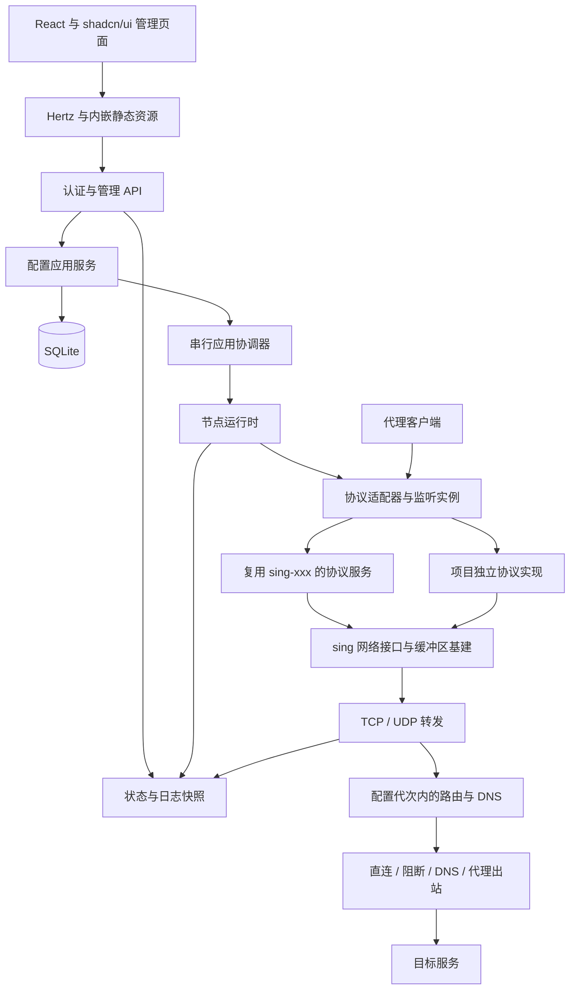

# Lunaris 架构设计

状态：设计基线，基础工程骨架已建立，业务能力仍按阶段实现。日期：2026-10-31。

本文确定模块边界和技术方案；[配置生命周期](configuration-lifecycle.md) 定义应用、回退与恢复语义；[管理 API 契约](management-api.md) 定义前后端交互。文中的类型、路径和命令是实现约定，并非已经存在的程序功能。

[Polaris 参考对照](polaris-reference.md) 记录共享转发、实例生命周期和 sing 接入的参考来源与采用范围。Polaris 的面板业务、无状态运行和本地依赖替换方案不改变 Lunaris 的自用 Web 管理定位。

当前实施顺序以 [开发计划](development-plan.md) 为准：先完成可独立运行的节点核心，HTTP API 与 Web 后置。直接引用上游模块，不维护本地 vendor 或本地模块替换。

P2 节点运行时已提供差异重载、凭据轮换、失败补偿和脱敏状态，见 [运行重载](runtime-reload.md)。P3 已通过本机应用服务和 CLI 提供 SQLite 版本提交与重启恢复，见 [持久化配置服务](persistent-configuration.md)；证书资产已在 P4 接入；P5 已提供管理员身份与管理 API，Web 交互留待 P6。详见[管理 API 实现](management-implementation.md)。

## 1. 产品边界与技术选择

Lunaris 面向个人自用、自托管：在自己的服务器安装一个程序，通过浏览器配置并运行代理协议。必须直接依赖 `github.com/sagernet/sing` 作为协议与网络基础设施；协议可以复用 `sing-xxx`，也可以在项目内独立实现。两条路径都以 sing 基建为基础，不 fork sing-box，不将 `github.com/sagernet/sing-box/...` 引入生产依赖。

已确定的产品边界是内置 Web、本机管理、协议节点专用；React + shadcn/ui、Hertz、GPL-3.0 以及统一 sing 基建是明确技术约束。以下表格同时列出这些约束和本次设计补充的实施选择：

| 项目 | 选择 | 目的 |
| --- | --- | --- |
| 部署单元 | 一个 Go 可执行文件、一个进程 | 安装和升级简单 |
| 运行环境 | 优先 Linux amd64 / arm64；macOS 用于开发 | 先覆盖常见自托管服务器 |
| 后端 | Go + CloudWeGo Hertz，内部模块组成的单体 | Hertz 提供 Web 服务，应用层组装节点运行时 |
| 前端 | React + TypeScript + shadcn/ui + Vite，静态 SPA | 管理表单与状态视图，随程序发布 |
| 前后端接口 | 同源 JSON HTTP API，统一 `{code,msg,data}` 信封，短轮询获取状态 | 首版不需要 WebSocket 或事件中间件 |
| 启动设置 | YAML | 仅管理部署设置；代理配置由 JSON API 写入 SQLite |
| 数据存储 | SQLite + `database/sql` + `modernc.org/sqlite` | 本地事务、配置版本和操作记录，无外部数据库 |
| 静态资源 | `web/dist` 通过 `go:embed` 编入程序 | 节点服务器不需要 Node.js 或独立前端服务 |
| 网络基建 | 必选的 `sing` 直接依赖 | 库接入与独立协议实现共用网络类型、缓冲区与连接处理 |
| 协议集成 | `sing-xxx` 适配或项目独立实现，编译期显式注册 | 两种来源使用同一运行时契约，不引入动态插件系统 |
| 配置应用 | 单个串行协调器，按监听器差异重建 | 保留 Web 访问和未变更监听器 |
| 开源许可 | GPL-3.0，项目 SPDX 标识采用 `GPL-3.0-only` | [仓库许可证](../LICENSE) 固定使用第 3 版 |

选择 SQLite 是为了将配置版本、引用和操作提交放在同一事务中；此处属于应用本地存储，符合 SQLite 的定位。[SQLite 用途](https://sqlite.org/whentouse.html)。`modernc.org/sqlite` 提供不依赖 CGo 的驱动，具体版本与平台构建需要在接入时锁定和验证。[驱动文档](https://pkg.go.dev/modernc.org/sqlite)。

不建设机场面板对接、套餐和计费上报、多租户、跨节点调度、TUN、系统代理或客户端策略组。多份协议凭据只是本机配置，不扩展为统一用户中心。当前支持直连、阻断、DNS 处理，以及与 Polaris 出站工厂对齐的代理协议，见[代理出站](outbounds.md)。多跳出站链、自动证书、无中断更新按实际需求追加。

## 2. 运行结构



管理服务、配置协调器、代理运行时在同一进程内，拥有独立生命周期。代理监听失败或重建不会主动停止管理服务；浏览器退出不影响数据转发。进程崩溃仍会同时影响两者，不把模块隔离描述成进程级容错。

数据面只使用已经装配好的内存配置、协议凭据和证书。握手、TCP 复制、UDP 收发不查询数据库、不调用管理 API、不等待浏览器事件。数据库运行中故障时，已经运行的代理实例可以继续工作；管理写操作停止并显示故障，不能绕过认证提供临时管理入口。

### 模块与依赖方向

| 模块 | 负责 | 边界 |
| --- | --- | --- |
| `model` | 配置、版本、协议类型、错误和状态的共享类型 | 不依赖 HTTP、SQL 或上游协议实现 |
| `admin` | Hertz 路由、中间件、登录会话、请求校验、响应脱敏 | 调用应用服务，不直接修改监听器或执行 shell |
| `config` | 草稿保存、引用校验、差异计划、串行应用协调 | 定义所需存储与运行时接口，不持有活动 socket |
| `store` | SQLite、迁移、不可变资源、事务与备份 | 不决定何时重启协议 |
| `node` | 活动实例、运行代次、状态收集、启停与补偿恢复 | 不依赖 HTTP 路由和数据库实现 |
| `protocol` | sing-xxx 适配或基于 sing 的独立协议实现、认证与生命周期 | 必须使用 sing 基建；不依赖管理 API 和存储 |
| `transport` | TCP/UDP socket、TLS 适配、资源跟踪 | 不建设任意传输组合平台 |
| `relay` / `egress` | TCP/UDP 转发、选源、底层拨号和超时 | 不理解管理员、草稿或配置事务 |
| `policy` / `route` / `dns` | 配置代次、逐包选路、解析与缓存 | 不读取管理数据库 |
| `outbound` | 出站工厂、能力校验、协议客户端和连接回收 | 注入底层拨号器，不复用入站配置结构 |
| `observability` | 有界日志、聚合计数、运行快照 | 不在数据路径上写计费数据库 |

接口由使用方定义，只在需要替换上游适配或模拟故障的位置引入。根目录 `main.go` 负责进程入口和信号，`cmd/run.go` 负责命令分发与依赖组装，显式注入依赖；不使用全局服务定位器和隐式插件注册。

Hertz 只承担管理 Web 的连接与请求生命周期。应用服务接收标准 `context.Context` 和独立 DTO；不保存 Hertz `RequestContext` 或借用的请求缓冲区。长操作登记后复制必要数据，由协调器上下文驱动。代理 TCP/UDP 数据面继续使用 sing 基建，不迁入 Hertz 的 HTTP 连接模型。进程信号由 `cmd` 统一协调关闭。

## 3. 仓库结构

```text
main.go                      进程入口与信号
cmd/run.go                   CLI 与依赖组装
config.example.yaml         启动配置样例
internal/
  model/                     本机配置与运行状态类型
  admin/                     Hertz HTTP、认证、DTO、错误映射
  config/                    草稿、计划、应用协调器
  store/sqlite/              存储实现与版本迁移
  node/                      协议实例管理、运行代次、退出
  protocol/
    registry.go              显式登记已编译的适配器
    shadowsocks/             独立协议适配器
    hysteria2/                后续协议按需增加
    <protocol>/              独立实现同样放在协议目录，基于 sing
  transport/                 socket、TLS、资源跟踪
  relay/                     TCP 与 UDP 数据转发
  egress/                    底层解析、选源与直接拨号
  outbound/                  代理协议客户端与连接回收
  observability/             日志、状态、计数
web/
  embed.go                   嵌入 dist 并提供 fs.FS
  src/
    app/                     路由与应用外壳
    api/                     类型化客户端、错误映射
    features/                setup、login、overview、listeners、certificates、logs、settings
    components/ui/           shadcn/ui 组件源码
    components/              业务共用组件
    hooks/                   React hooks
  dist/                      构建生成，不手动维护
api/openapi.yaml             实现阶段建立的接口契约与类型生成来源
migrations/                  按序执行的数据库迁移
packaging/systemd/           服务文件
scripts/                     构建与发布入口
```

这是目标结构，不创建没有实现的空包。`protocol` 中列出的目录不代表协议已经接入。前端只依赖 API 契约，不依赖上游库的数据结构或数据库表。

## 4. 配置、资产和存储

### 三类配置

| 类型 | 存放与修改 | 内容 |
| --- | --- | --- |
| 启动设置 | 小型 `bootstrap.yaml`，部署工具或离线 CLI 修改 | 数据目录、管理监听地址、允许的访问来源、管理 HTTPS、可信反代 |
| 受管节点配置 | SQLite 不可变版本，通过 JSON API 修改，P6 接入 Web | 协议监听、凭据引用、证书引用、出口和资源选项 |
| 运行状态 | 内存快照，通过 API 读取 | 启停状态、实际 socket、运行代次、错误、连接数 |

节点 YAML 及文件运行入口已移除。`serve` 与 `managed` 都只恢复 SQLite 的 committed；前者提供在线管理 API，后者只运行代理。CLI 的配置查询、历史恢复、应用和备份直接访问本机 SQLite，要求对应节点已停止。

启动设置不包含代理协议配置，避免两个配置源互相覆盖。首版管理地址和管理 HTTPS 的改变通过部署配置加服务重启完成，不与代理“应用配置”混在一起。Web 是日常节点配置入口，CLI 用于安装引导、管理访问恢复与故障诊断。

仅启动设置使用严格 YAML，限制大小并拒绝未知字段、重复键和多文档。代理配置仅接受结构化 JSON API，不提供 YAML 导入、模板导出或本机文件/环境变量引用。`examples/*.json` 是 API 请求体示例，不能作为启动文件；SQLite 中的规范化 JSON 是不可变版本快照。

### 主要对象

- `NodeConfig`：带 `schema_version` 的完整配置快照，包含监听器、路由/DNS、GeoData 绑定和资源选项。
- `ListenerSpec`：稳定 ID、名称、启用状态、协议类型、bind 地址和端口、该协议专属选项、凭据和证书引用。协议选项是带类型标记的联合类型，拒绝不认识的字段和组合。
- `CredentialAsset`：不可变 ID、协议种类、可选标签和协议需要的秘密材料。多个设备可使用不同凭据；不引入全局用户 ID。
- `CertificateAsset`：不可变 ID、证书链、私钥、指纹与有效期。替换证书生成新 ID，不在原记录上改私钥。
- `ConfigRevision`：版本 ID、父版本、标准化配置 JSON、摘要、创建时间。保存新版本时不覆盖旧版本。
- `ApplyOperation`：目标版本、基准版本、请求幂等键、执行状态、影响列表和脱敏错误。
- `RuntimeSnapshot`：进程 `boot_id`、已提交配置版本、每个监听实例的代次、状态和实际配置摘要。重启后重新观测，不从数据库伪造“运行中”。

API 返回的配置只含不透明资产引用；凭据更换先创建新资产，再生成引用它的新配置版本。旧版本引用的资产保留，保证恢复旧配置时不会误用新密码或新证书。

配置版本的摘要覆盖完整文档；实例的 `spec_digest` 只覆盖影响运行的规范化字段，排除展示名称等元数据。更改名称可提交新版本而保留原实例，连接信息校验也按运行字段摘要比较。

### SQLite 表与事务

| 表 | 内容 |
| --- | --- |
| `config_revisions` | 不可变配置 JSON、父版本、摘要、schema 版本 |
| `config_heads` | 单行：`draft_revision`、`committed_revision` |
| `credentials` / `certificates` | 不可变协议资产与秘密材料 |
| `apply_operations` | 状态、目标/基准、幂等键与请求摘要 |
| `admin_account` / `admin_sessions` | 单管理员密码哈希、会话 token 哈希、过期时间 |
| `installation` | 节点标识、初始化状态、一次性初始化 token 的哈希与有效期 |
| `schema_migrations` | 已应用的数据库迁移 |

采用 WAL、开启外键、配置忙等待超时和 `synchronous=FULL`。应用层串行执行配置写入，不在 SQL 事务中进行 socket 操作、TLS 握手或等待连接排空。数据库使用本机磁盘，不支持多个进程或多个服务器共享同一数据目录。[SQLite WAL 文档](https://sqlite.org/wal.html)。

运行目录使用进程锁保证单实例，离线恢复工具必须取得同一把锁。历史清理按引用进行：草稿、已提交版本、正在执行的操作和保留的历史版本引用的资产不能删除。定期清理过期会话与无引用资产，限制历史和日志容量。

管理员密码使用带随机盐的 Argon2id 哈希，参数持久化并针对目标机器约束登录并发。[Argon2 文档](https://pkg.go.dev/golang.org/x/crypto/argon2)。代理协议密钥和 TLS 私钥需要供服务使用，不能只存密码哈希。首版依靠本机数据目录 `0700`、数据文件 `0600` 和服务账户隔离，不声称数据库具备额外的静态加密。完整备份包含秘密材料，普通配置 API、日志和状态中不返回这些内容。

## 5. 协议接入与数据面

### 上游复用矩阵

| 协议或基础能力 | 来源 | 适配工作 |
| --- | --- | --- |
| 网络接口、缓冲区、地址和复制 | [sing](https://github.com/SagerNet/sing/tree/dev/common) | 资源所有权、元数据、超时与完成回调 |
| Shadowsocks / 2022 | [sing-shadowsocks](https://github.com/SagerNet/sing-shadowsocks) | TCP/UDP 监听、密码套件、凭据配置 |
| VMess / VLESS | [sing-vmess](https://github.com/SagerNet/sing-vmess) | TLS、必要传输、认证和连接关闭 |
| Hysteria2 / TUIC | [sing-quic](https://github.com/SagerNet/sing-quic) | UDP socket、TLS、QUIC 会话和子流 |
| AnyTLS | [sing-anytls](https://github.com/SagerNet/sing-anytls) | TLS、凭据、复用会话生命周期 |

候选库不等于协议支持承诺。首版协议组合仍需根据实际客户端选择；架构不依赖一次接入所有协议。某个协议没有合适的 sing-xxx 服务端库时，可以在 `internal/protocol/<name>` 独立实现，仍接入以下相同契约。

### sing 基建约束与两种实现来源

`sing` 是根模块的必选直接依赖，不只是被某个可选协议间接带入。所有协议的连接边界统一使用 `sing/common/network` 的 TCP/UDP handler 和 PacketConn、`sing/common/metadata` 的地址类型；数据读写按需复用 `sing/common/buf`、`bufio`，日志、错误、认证上下文和 UDP 会话工具也优先使用 sing 的相应能力。

| 实现来源 | 协议服务如何构建 | 共享的接入出口 |
| --- | --- | --- |
| 库适配 | Lunaris 适配器创建 sing-xxx 的 service 并配置凭据、传输 | sing handler → relay → egress |
| 项目独立实现 | Lunaris 编写握手、认证、帧编解码与会话逻辑，直接使用 sing 的类型与 I/O 基建 | sing handler → relay → egress |

独立实现不能只添加一个无实际用途的 sing import；协议包必须在连接接口、地址处理和数据 I/O 上使用上述基础设施。不再另建一套与 sing 平行的 PacketConn、缓冲池和地址类型。标准库的 `net.Conn`、TLS 和密码学原语可以在 sing 的接口体系内使用。

协议来源不影响 Web 配置、能力描述、实例启停和状态上报。独立实现还需增加协议规范映射、解析器畸形输入/fuzz 测试，以及独立客户端互通测试；不通过测试用客户端复用同一解析器来证明全部兼容性。

核对到的上游边界：`sing-shadowsocks2` 的 [README](https://github.com/SagerNet/sing-shadowsocks2/blob/dev/README.md) 仍将服务端列为未完成。VLESS 的协议服务不自动包含全部 REALITY 与 WebSocket/gRPC 组合；sing-box 的 [VLESS 接入层](https://github.com/SagerNet/sing-box/blob/testing/protocol/vless/inbound.go) 还负责 TLS 和传输。其 [Trojan 接入层](https://github.com/SagerNet/sing-box/blob/testing/protocol/trojan/inbound.go) 使用 sing-box 自身的 transport，Trojan 已在 Lunaris 中基于 sing 独立实现，当前组合见[协议与传输说明](protocols.md)。

### 适配器契约

协议工厂和传输工厂分别注册，由 `internal/inbound` 组合。协议工厂提供能力描述、校验和协议回调构建，传输工厂构建可启停实例。详细契约与扩展方式见[工厂注册表](factory-registries.md)。节点只接受程序实际编译并验证过的协议组合；前端根据能力描述显示表单，后端始终再次校验。

以下为概念接口，不是承诺导出的 SDK：

```go
// 接口草图：N 是 github.com/sagernet/sing/common/network。
type RelayHandler interface {
    N.TCPConnectionHandlerEx
    N.UDPConnectionHandlerEx
}

type ProtocolFactory interface {
    Capabilities() ProtocolCapabilities
    Validate(spec ListenerSpec) []FieldError
    Build(spec ResolvedListenerSpec, deps Dependencies) (transport.Binding, error)
}

type TransportFactory interface {
    Capabilities() TransportCapabilities
    Validate(spec ListenerSpec) []FieldError
    Build(spec ResolvedTransportSpec, binding transport.Binding) (Instance, error)
}

type Instance interface {
    Start(ctx context.Context) error
    Events() <-chan InstanceEvent
    Stop(ctx context.Context) error
}
```

`Dependencies` 中的转发回调使用这个 `RelayHandler`，并携带 sing logger 等公共依赖。协议不支持的网络类型不会触发相应回调；适配器负责注入监听器 ID、实例代次和认证凭据标签。

- 协议 `Build` 接收已解析的凭据并返回回调；传输 `Build` 接收监听设置、证书与这些回调。二者不访问数据库、不绑定监听端口、不启动后台循环；失败释放构建资源。
- `Start` 拥有实例生命周期上下文，建立全部必需 socket 和接收循环后才返回成功。HTTP 请求取消不取消节点实例。部分启动失败必须可由 `Stop` 完整清理。
- `Events` 提供有界生命周期状态，运行时维护最终状态快照；致命退出不能仅靠可能丢弃的日志传播。
- `Stop` 幂等，停止接入并关闭所属 socket、TCP 连接、UDP 会话、QUIC 连接、子流和定时器；截止时间到达时强制回收。不是只关闭 QUIC listener 就算结束。
- 首版实例替换会中断该监听器的现有连接，应用计划明确列出影响。普通退出可以有限时间排空；凭据撤销不保留旧认证会话。

`sing/common/network` 提供 TCP/UDP handler、packet connection 和关闭回调；适配器统一向 relay 提交 `ListenerID`、实例代次、凭据标签、源地址、目的地址与协议连接。[网络接口源码](https://github.com/SagerNet/sing/blob/dev/common/network/conn.go)。不把认证信息从浏览器请求带入数据面。

### 转发规则

TCP：协议认证与请求解析 → 解析/拨号目标 → 按协议约定报告握手结果 → 双向复制 → 半关闭或取消 → 恰好一次资源关闭与回调。握手确认使用上游支持的接口，不让目标拨号失败被误报成代理成功。[握手接口源码](https://github.com/SagerNet/sing/blob/dev/common/network/handshake.go)。

参考 Polaris 的共享流处理，在解析/拨号之前将工作登记到监听实例与本地凭据引用；拨号成功后再转为活动转发。重建或撤销时取消待连接工作，释放刚建立但已失去所属实例的上游，避免只跟踪开始复制后的连接。具体参考源码见 [Polaris 对照](polaris-reference.md)。

UDP：保留数据报边界与每包目标地址，建立有界映射，处理域名解析与响应来源，并按空闲时间回收。QUIC 承载的 UDP 与底层 QUIC socket 分清所有权。实例资源表跟踪尚未进入 relay 的握手和已认证长会话，确保凭据撤销覆盖旧会话中新开的流。

传输或 Vision 依赖的接口不能被通用包装器隐藏。仅在协议完成必要封装后接入统计，并验证 `ReadFrom`、`WriteTo`、buffer 接口和上游 unwrap 路径不会绕过需要执行的逻辑。计数按监听器聚合、随进程重启清零，用于排障，不做计费账本。

代理连接包装应保留 sing 的半关闭和扩展 I/O 能力；当前 Hertz 管理连接追踪器仅用于管理面，不能直接复用为代理连接包装。共同的停止接入、有限排空与强制关闭逻辑由节点/传输层承载，协议适配器负责协议握手、编解码和会话处理；所有监听 socket 与 QUIC transport 由传输实例持有。

默认系统解析器与直接拨号；提供明确的握手、拨号、UDP 空闲和退出超时。握手并发、连接数、QUIC 流和 UDP 会话都需要有限上界。具体默认数值在协议接入压测后确定，不照搬库中可能极大的默认值。

## 6. Web 与管理员访问

### 前端结构

使用 React + TypeScript、React Router 的浏览器路由、shadcn/ui 组件和配套 Tailwind CSS，Vite 生成静态产物。[React 文档](https://react.dev/learn/creating-a-react-app)、[shadcn/ui 的 Vite 接入](https://ui.shadcn.com/docs/installation/vite)、[Vite 构建文档](https://vite.dev/guide/build)。组件源码纳入 `web/src/components/ui`，业务组件组合使用，不将业务逻辑堆进基础组件。

运行时页面无 CDN 依赖。Hertz 提供同源 API 和静态路由；内嵌文件系统通过 `fs.Sub` 限定到 dist，配合官方 `adaptor.HertzHandler` 接入标准库文件 handler，不启动第二个 `net/http` Web server。[Hertz 官方适配文档](https://www.cloudwego.io/docs/hertz/tutorials/basic-feature/http-adaptor/)。只为已知前端页面的 GET/HEAD 请求回退入口 HTML；`/api/*`、缺失资源和不支持的方法保持错误响应。

| 页面 | 数据与动作 |
| --- | --- |
| 初始化 / 登录 | 初始化状态、一次性凭据、管理员会话 |
| 概览 | 节点状态、待应用修改、监听器状态、最近错误 |
| 协议监听 | 按协议表单增删改、凭据引用、启停配置 |
| 证书 | 导入证书、有效期、引用列表、替换预览 |
| 日志 | 有界游标分页、筛选、清空本地展示 |
| 设置 | 管理员密码、版本与诊断 |

服务状态由 API 维护，表单编辑状态留在页面；草稿保存成功后重新读取服务端版本。首版使用类型化 `fetch`、React hooks 和局部状态，不同时引入多套全局状态和请求缓存。协议秘密只留在短期表单内存，提交后清除，不写入 localStorage。

状态短轮询仅在页面可见时执行；应用操作按 operation ID 查询，超时不重新创建操作。错误以字段路径和稳定错误码显示。端口、密码、TLS 等项目按协议显示，避免用户配置不存在的组合。组件库固定为 shadcn/ui，视觉方向在页面实现前确定。

### 首次启动与登录

首版默认管理服务绑定 `127.0.0.1:9080`，安装提示通过 SSH 本地转发打开浏览器完成初始化。已有域名或反代的部署可通过启动设置选择原生 HTTPS 或可信反代模式；公网直接访问必须使用 HTTPS，不提供无认证的首次抢占注册。

管理服务使用 Hertz 的标准网络 transport 作为首版基线，以覆盖原生 TLS 与本地开发；不把管理面的网络引擎选择强加给 sing 数据面。Hertz 当前文档说明原生 TLS 使用标准网络库，并非 Netpoll TLS。[Hertz TLS 文档](https://www.cloudwego.io/docs/hertz/tutorials/basic-feature/tls/)。

初始化 token 随机生成、有有效期，哈希存储；原文只放权限受控的安装文件，安装端显式提供给操作者，不写普通服务日志。Web 成功创建单管理员后，在同一事务中作废 token 并关闭初始化入口，随后清理安装文件。

使用服务端会话和 HttpOnly cookie，默认 SameSite=Strict；HTTPS 模式启用 Secure。仅回环 HTTP 隧道模式允许非 Secure cookie，不允许将该模式直接绑定公网。登录限流，修改密码撤销现有会话；修改操作校验 CSRF token 和允许的 Origin/Host，反代头仅信任配置的来源。后台不启用任意跨域访问。

普通配置读取不返回密码和私钥。需要展示客户端连接信息时，使用独立的已认证、重新确认管理员身份的导出动作，响应禁止缓存并不进入请求日志。

## 7. 部署、恢复与发布

建议的 Linux 布局：

```text
/usr/local/bin/lunaris        可执行文件与内嵌页面
/etc/lunaris/bootstrap.yaml  启动设置
/var/lib/lunaris/             数据库、进程锁、受控初始化文件
/run/lunaris/                运行时临时信息
```

服务账户运行，低端口按需授予绑定能力。前台模式便于诊断；systemd 管理重启与日志。CLI 规划包括 `serve`、`doctor`、`backup`、`restore`、`admin reset-password`，恢复或直接写数据库的命令要求服务停止并取得数据目录锁。

完整备份与还原走离线 CLI；当前包含 SQLite 中的配置、凭据资产、幂等操作及迁移状态，已纳入管理员账户、会话与证书数据；还原时撤销复制的会话。bootstrap、外部文件和服务单元需另行保管。P3 使用 SQLite `VACUUM INTO` 生成含 WAL 内容的一致快照，不直接复制数据库主文件。[SQLite 备份文档](https://sqlite.org/backup.html)。普通 JSON 配置查询不包含秘密材料，不能替代完整备份。

数据库迁移在代理启动前执行，先做一致备份并校验 schema；不兼容时明确失败，禁止自动创建空库掩盖损坏。配置有效但某个代理端口恢复失败时，保留已认证管理入口和其他成功实例。数据库打不开或认证数据不可用时，不打开免认证修复接口，使用本机 CLI 恢复。

发布先安装锁定的前端依赖并构建 `web/dist`，再通过 `go:embed` 编译 Go。[Go embed 文档](https://pkg.go.dev/embed)。缺少静态资源必须使发布失败。HTML 与 API 响应不缓存，带内容摘要的静态资源可长期缓存；页面检测前后端版本变化后提示刷新，不允许旧页面继续提交未知字段。

Go、Hertz、前端依赖和 sing 系列依赖统一锁版本；sing 必须直接引用，sing-xxx 按协议需要引入。不维护本地 vendor、副本模块或本地 replace；依赖检查拒绝这些路径和 sing-box 模块，并在代码审查中检查独立协议对 sing 基建的实际使用。必要时将 sing-box 作为外部客户端二进制做互通测试。

项目采用 GNU GPL 第 3 版，以 `GPL-3.0-only` 标识，完整正文见 [LICENSE](../LICENSE)。第三方代码、生成的组件源码和依赖保留各自版权与许可证声明；发布记录依赖清单、构建版本和对应源码。GNU 原文来源：[GPL-3.0](https://www.gnu.org/licenses/gpl-3.0.html)。

## 8. 实施顺序与验收

| 阶段 | 交付 | 验收重点 |
| --- | --- | --- |
| P1：独立核心 | CLI、共享 relay、监听器、首个真实协议（原节点 YAML 入口已移除） | 无前端构建即可运行；TCP/UDP、认证失败、关闭和资源回收 |
| P2：运行管理 | 配置差异、实例状态、凭据轮换与补偿 | 失败不留下失控实例，旧连接按策略关闭 |
| P3：持久化服务 | 资产、配置版本、幂等应用、恢复工具 | 不依赖 HTTP 即可验证提交与崩溃恢复 |
| P4：协议与运维 | 按需扩展协议、证书及 Linux 部署 | 独立客户端与真实环境互通 |
| P5：HTTP API | Hertz 鉴权与管理接口接入应用服务 | 统一信封、版本和幂等语义 |
| P6：Web | 内嵌管理页面接入真实 API | 浏览器完整管理节点 |

核心阶段通过 CLI、应用服务和网络集成测试验证业务，HTTP 与 Web 后置。当前实际功能见 [README](../README.md)；架构中的认证、配置应用和其他代理协议不可因目录或接口已存在而视为交付。

首批协议、TCP/TLS、WebSocket、HTTPUpgrade 与 QUIC 组合已实现；后续继续收敛扩展传输和前端视觉方向。React + shadcn/ui、Hertz、GPL-3.0、sing 必选基础、单进程、本机 SQLite、内嵌前端与配置应用模型已有明确设计。

路由/DNS 的当前配置、GeoData 资产和代次回收说明见[路由与解析](routing-dns.md)。

认证扫描复用 `internal/authscan` 的有界候选缓存、CPU 扫描预算和来源退避；classic AEAD、VMess、Mieru 与 Snell 加密模式接入，完整边界见 [authscan](authscan.md)。
