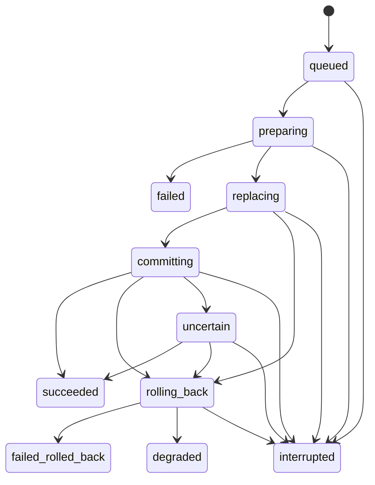
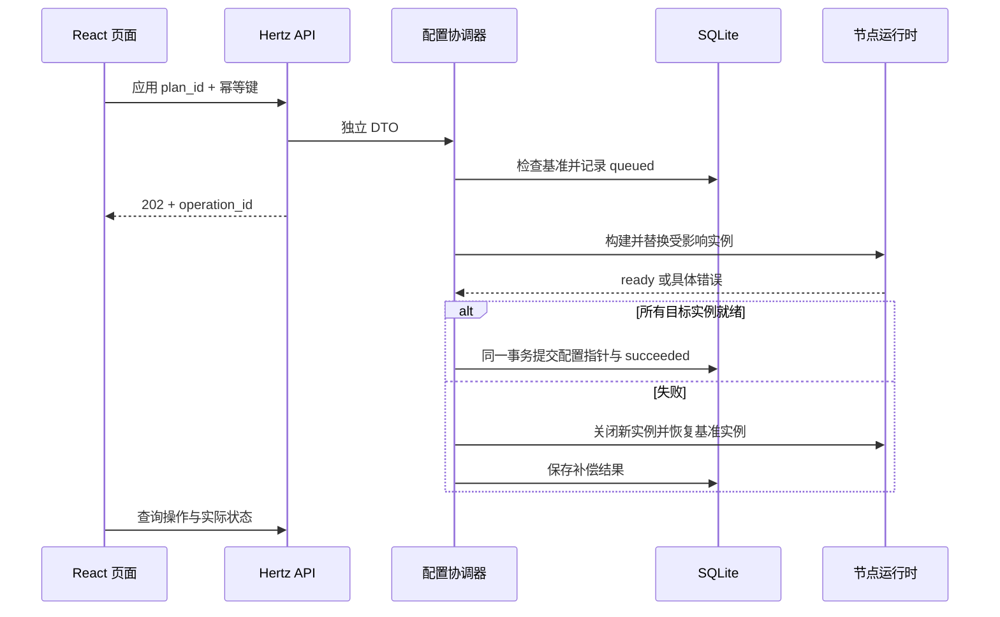

# 配置应用与恢复

本文描述 [总体架构](architecture.md) 的目标状态契约。P3 已实现不依赖 HTTP 的版本、资产、幂等应用与重启恢复，当前入口与具体状态见 [持久化配置服务](persistent-configuration.md)。本页中的 HTTP plan token、前端交互和更细的操作阶段仍为 P5/P6 设计。P2 文件模式差异应用见 [运行重载](runtime-reload.md)。

## 1. 不变量

1. 每次保存产生不可变配置版本，凭据和证书也以不可变资产 ID 引用。
2. `draft_revision` 是最近保存的候选版本；`committed_revision` 是最近成功应用并持久化提交的版本。
3. 已提交版本不等于此刻所有监听器仍然正常；实际状态必须从 node 的内存快照读取。
4. 一个进程内最多执行一个应用操作。配置应用、导入和资产删除不能绕过协调器。
5. 网络启停与 SQLite 不能组成原子事务。对外明确报告应用过程、补偿结果和实际资源状态。
6. 修改代理监听器不会重建 Hertz 管理服务。进程或数据库级故障仍按总体架构的恢复规则处理。
7. 未成功提交的草稿不会因为服务重启而自动生效。

首次初始化创建空配置版本 `r0`，草稿和已提交指针都指向它。没有代理监听器是正常状态，不阻塞 Web 初始化和配置。

## 2. 状态与版本

### 配置视图

| 数据 | 来源 | 含义 |
| --- | --- | --- |
| `draft_revision` | SQLite | 编辑和下一次应用的目标 |
| `committed_revision` | SQLite | 启动恢复时使用的配置 |
| `boot_id` | 当前进程 | 区分进程重启 |
| `runtime_epoch` | node | 监听拓扑或实例健康状态变化时递增 |
| `listeners[].generation` | node | 某个监听器的具体运行实例 |
| `listeners[].spec_digest` | node | 当前实例实际使用的配置摘要 |
| `listeners[].state` | node | disabled / starting / running / stopping / failed |

运行统计变化不增加 `runtime_epoch`，否则有连接经过就会使应用计划过期。运行事件由 node 统一处理，管理端拿到的是一致快照，不能拼接两个时刻的实例映射。

界面“有未应用修改”来自草稿与已提交指针不同；界面“运行异常”来自实际监听状态，两者可同时存在。历史版本不能通过直接改指针生效，必须复制为新草稿并经过正常应用流程。

### 操作状态

`failed` 表示未切换运行实例即失败；`failed_rolled_back` 表示本次操作失败但基准配置已恢复；`degraded` 表示补偿未能恢复全部应运行的实例。`uncertain` 用于数据库提交结果暂时无法确认，冻结后续配置修改，不能假报成功或立即猜测回退。

`interrupted` 是进程重启时整理出的结果。启动时若数据库显示操作已经与目标版本一起成功提交，则保留 succeeded；否则将未完成操作标为 interrupted，再恢复已提交配置。

## 3. 编辑与预览

### 保存

浏览器读取草稿及 ETag，带 `If-Match` 提交完整的、带资产引用的配置。服务端检查字段、协议能力、引用存在性，再在短事务中比较旧版本、插入新版本并移动草稿指针。过期的 ETag 返回 412，不覆盖另一标签页的修改。

Web 修改监听器、启停监听器、替换凭据、导入配置都转换为保存新草稿。没有绕过持久化的临时“启动/停止” API，以免程序重启后恢复成另一种状态。

资产创建是独立短事务，生成不可变 ID。保存失败留下的未引用资产可由有界垃圾回收清理；活动、历史和执行中操作引用的资产不得删除。凭据原文不进入配置 JSON。

### 预览计划

计划记录目标草稿、基准已提交版本、`boot_id`、`runtime_epoch`、差异摘要和过期时间。计划 ID 保存在有容量上限的短期内存缓存，重启后失效。前端不能自行修改计划的受影响实例列表。

计划将每个监听器分类为 `unchanged`、`create`、`replace`、`disable`、`remove`、`recover`：配置没有变化但运行实例缺失或失败时，仍需 recover。证书和凭据引用的变化属于运行配置变化；只改展示名称可以保留原实例。

预检查包含：

- 协议及传输组合是否被当前构建支持，字段和凭据格式是否有效。
- 证书与私钥匹配、必要文件或资产是否可读、版本是否兼容。
- 所有目标监听端点与管理端点是否冲突，考虑 TCP/UDP、IPv4/IPv6、通配地址重叠。
- 哪些存量连接会中断，是否涉及端口交换或复用中的旧端点。

不以预检查保证端口一定能绑定。其他进程可以在随后占用端口，最终以 Start 的真实结果为准。预览不停止服务，也不为测试而抢占正在使用的端口。

## 4. 应用算法

具体步骤：

1. **受理**：先按管理员、路由、幂等键和规范化请求摘要查重。同键同请求返回原操作；同键不同请求返回 409。随后检查计划仍有效、草稿/基准/运行拓扑仍匹配，获取协调器的应用锁并持久化操作，成功后才返回 202。数据库写入失败不执行网络变更。
2. **冻结变更**：首版应用期间拒绝其他草稿保存、资产变更、导入或第二个应用，返回可查询的忙状态；日志、状态查询和登录会话仍可用。配置锁是应用层锁，不能持有跨整个操作的 SQL 事务。
3. **准备**：解析所有不可变资产，构建目标实例、TLS 对象和差异计划。每个实例持有独立 TLS 配置，不能让上游修改共享对象。构建不绑定端口；失败释放新资源，旧实例继续工作。
4. **替换**：先关闭全部受影响旧实例及其存量会话，确认其端点已释放，再启动目标实例，覆盖端口交换的情况。未修改实例保持运行。首版不使用 SO_REUSEPORT 假装两个版本可以原子切换。
5. **确认就绪**：目标中所有应启用的监听器完成所需 socket 绑定和接收循环启动，且没有已知致命退出。这里不代表外网可达性或任意目标的连通性已经验证。
6. **持久化提交**：在一个 SQLite 事务中更新 committed 指针与操作 succeeded；更新 node 对外的已提交版本视图。成功前不向浏览器报告完成。
7. **失败补偿**：关闭本次创建的所有目标实例，用基准版本的资产重建受影响旧实例。确认恢复结果再标记 failed_rolled_back；恢复不全标记 degraded，列出每个失败监听器，不改 committed 指针。
8. **结束**：释放计划资源和应用锁；草稿保持用户保存的内容，包括失败的目标版本，便于修复。成功时 draft 与 committed 相同，失败时通常不同。

如果旧实例未能完全停止，禁止继续启动占用其端点的目标实例，也不能直接从资源表删除旧实例并声称端口已释放。协调器报告实际仍存活的资源并进入失败恢复；不能恢复一致状态时标记 degraded，保留管理入口处理。

受理后的操作由进程级上下文和有界阶段超时驱动，浏览器关页、HTTP 超时或退出登录不撤销已受理操作。首版不提供中途取消，避免在 socket 替换中途留下未定义状态。

### 必须呈现的限制

网络操作无法与配置提交同时原子发生。替换期间新实例可能已经短暂接收流量，最终失败时这些连接会关闭；旧连接也不能在补偿时复活。多监听器应用是带补偿的操作，不宣传为无中断事务。

凭据删除或轮换在成功替换并关闭旧会话后才算生效。若操作失败且恢复旧版本，旧凭据仍有效，界面必须直接说明。成功提交后不因为后来发生网络故障而自动回退到含旧凭据的配置。

## 5. 崩溃和故障恢复

| 故障位置 | 重启或处理结果 |
| --- | --- |
| 草稿已保存，尚未应用 | 从 committed 恢复；保留待应用草稿 |
| queued / preparing | 标记 interrupted；从 committed 恢复 |
| 旧实例已停或目标实例部分启动，尚未提交 | 进程退出释放 socket；重新启动 committed，目标草稿保持未生效 |
| 提交事务已完成，响应尚未送达 | 读取到目标 committed 与 succeeded；恢复目标版本，幂等查询返回原操作 |
| COMMIT 返回错误且结果未知 | 重读操作和 committed 判断；确认成功则完成，确认未提交才补偿，无法读取则 uncertain |
| 恢复旧实例时端口被占用 | 显示 degraded / failed 实例，保留管理入口，不谎报回退成功 |
| 已成功提交后某监听器发生致命退出 | committed 不变，实际状态 failed；用户可生成 recover 计划，不自动恢复旧凭据 |
| 数据库无法读写，但进程仍活着 | 代理继续使用内存状态；拒绝配置变更，显示可获得的故障信息 |

数据库损坏或 schema 不兼容时，进程不能生成空数据库覆盖现场，也不能绕过登录开放修复页面。与“某个代理恢复失败、管理仍可用”的情况区分，使用离线恢复命令。

补偿结果若暂时无法落盘，内存状态仍反映实际情况，但停止接受后续变更；重启后以数据库提交指针为依据重建，不回放未完成操作。所有后台资源必须在进程停止时有界退出。

## 6. 验收用例

- 两个浏览器同时保存：后到的旧版本写入得到 412，已有数据不丢失。
- 保存成功但应用失败：界面展示草稿与实际运行差异，重启不误启草稿。
- 同一应用请求重发：只创建一次操作、只执行一次实例替换。
- 两个监听器交换端口：先释放完整冲突集合；失败时恢复完整基准集合。
- 第二个新实例启动失败：第一个新实例被清理；补偿后无重复 listener、goroutine 和 socket。
- 原凭据已有 QUIC 会话：成功轮换后旧会话不能新开流，也不能继续转发。
- 在替换前、部分启动后、提交前、提交后注入进程退出：恢复到规定版本。
- 配置不变但实例死亡：生成 recover 计划并恢复；不得错误报告“无需变更”。
- 代理应用全过程中，Hertz 状态和修复入口可访问；日志读取不会阻塞代理或协调器。
