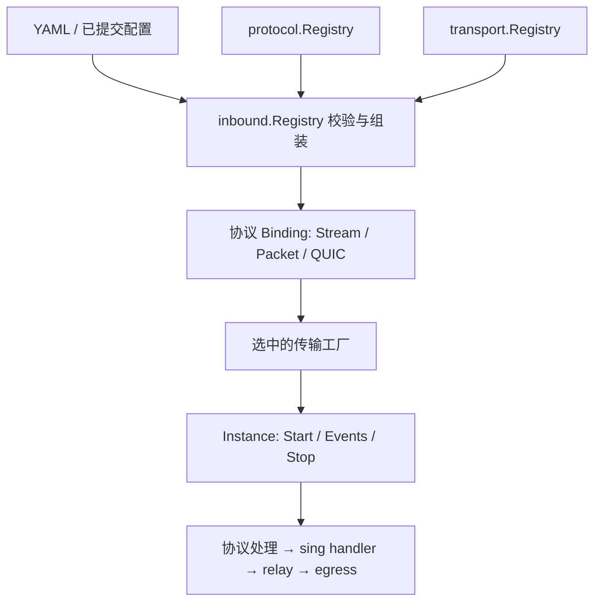

# 协议工厂与传输工厂注册表

Lunaris 使用两个独立、构造后只读的注册表，由 `internal/inbound` 组合。



## 两个注册表

| 注册表 | 注册项 | 职责 |
| --- | --- | --- |
| `protocol.Registry` | Shadowsocks、VLESS、VMess、Trojan、AnyTLS、Hysteria2、TUIC 各自的 `Factory` | 协议能力、选项和凭据校验，创建协议处理器 |
| `transport.Registry` | `NativeFactory`、`TCPFactory`、`WebSocketFactory`、`HTTPUpgradeFactory`、`QUICFactory` | 传输配置校验，创建并拥有监听 socket、TLS、升级连接和 QUIC transport |

注册表拒绝 nil 工厂、空类型和重复类型，通过 `Lookup` 查找，通过 `Capabilities` 返回排序后的能力。不会通过包初始化函数隐式注册，也不在请求处理过程中修改注册表。

两个注册表可以独立构造、替换或裁剪。默认入口分别是 `protocol/builtin.NewProtocols()` 和 `transport/builtin.NewRegistry()`；`protocol/builtin.NewRegistry()` 是默认组装入口，返回 `*inbound.Registry`。

TLS 保持为 TCP/HTTP 传输的可选封装，由 `certificate_ref` 启用；它不是另一个互斥的 `transport.type`。QUIC 必须使用 TLS。`native` 表示原生 TCP/UDP 套接字组，Shadowsocks 省略 `transport` 时选择它，原有 YAML 和存储快照不需要迁移。

## 构建契约

```go
// internal/protocol
// Build 仅准备协议状态和回调，不监听端口、不启动后台工作。
type Factory interface {
    Capabilities() Capabilities
    Validate(model.ListenerSpec) []model.FieldError
    Build(ResolvedListenerSpec, Dependencies) (transport.Binding, error)
}

// internal/transport
// Build 仅构建实例，Start 才开启网络资源。
type Factory interface {
    Capabilities() Capabilities
    Validate(model.ListenerSpec) []model.FieldError
    Build(ResolvedSpec, Binding) (Instance, error)
}
```

协议工厂声明允许的传输及 TLS 要求；传输工厂校验自己的 path、Host 和 TLS 条件。组装层校验类型存在、协议允许该传输、套接字网络存在交集、TLS 策略和资产引用。省略 `network` 时使用双方能力交集。

协议构造器收到凭据和逻辑配置，不收到证书链或私钥；传输构造器收到监听设置、TLS 材料和协议回调，不收到密码或协议选项。协议认证后的连接继续进入同一个 sing relay。

`Binding` 保留三种实际接入边界：

- `StreamHandler`：接收解封装后的 `net.Conn`，可提供协议 Start/Close 钩子；用于 SS TCP、VLESS、VMess、Trojan 和 AnyTLS。
- `PacketHandler`：接收传输层创建的 `net.PacketConn`，负责协议数据报与会话；用于 SS UDP。传输层关闭 socket，协议层关闭关联会话和队列。
- `QUICHandler`：提供上游 QUIC service 构造函数、ALPN 和协议控制流名额。传输实例启动时传入生命周期 context、受跟踪 TLS 配置和受限 QUIC 选项，上游 service 仍通过 `sing-quic` 完成协议握手。

QUIC transport 的创建、连接准入和回收统一位于 `internal/transport/quic.go`，其中不判断 Hysteria2/TUIC 类型。TCP/HTTP 的共用 socket 运行时也不根据传输名字分支：各工厂分别注入原始流、WebSocket 或 HTTPUpgrade 的处理函数。

## 扩展方式

1. 新协议在 `internal/protocol/<name>` 实现工厂，声明允许的传输，返回相应 `Binding`，在协议内置清单中登记。
2. 新传输实现 `transport.Factory`，提供能力、校验与构建函数，在传输内置清单中登记。
3. 为需要使用新传输的协议显式声明该组合，并加入真实互通与生命周期测试。

扩展不需要修改运行时组装器或公共传输类型 switch。`internal/inbound/registry_test.go` 用任意命名的测试协议/传输，通过注册完成真实 TCP 转发，覆盖这个扩展边界。

## 生命周期与验证

停止实例时传输层关闭 socket 和全部载体，再等待协议清理。`Stop(ctx)` 的截止时间只限制当前调用的等待；清理继续持有资源，后续 `Stop` 可以确认最终释放。运行时在未确认释放时继续保留所有权并阻止不安全替换。

回归覆盖注册冲突、空工厂、缺失传输、组合拒绝、默认网络交集、能力快照、UDP 部分绑定失败、停止截止后继续清理、既有凭据/证书轮换和故障恢复。客户端互通通过 `scripts/test-interop.py` 复跑；支持范围仍以[协议与传输矩阵](protocols.md)为准。
