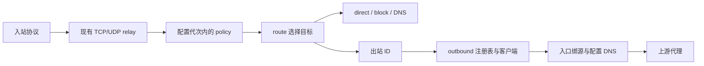

# 代理出站

Lunaris 的出站由路由选择，使用独立协议客户端连接上游代理。配置、凭据和应用流程沿用 JSON API 与 SQLite 版本管理。当前代理协议种类与 Polaris `56d52fb44958ef3cc2a7fb841cd240f8206234b2` 的出站工厂对齐。使用当前锁定的 sing、sing-shadowsocks、sing-vmess、sing-anytls、sing-quic 与现有协议 wire，无 sing-box 生产依赖。

## 协议能力

| 出站 protocol | TCP | UDP | 认证与传输 |
| --- | --- | --- | --- |
| `socks4` | CONNECT，目标仅 IPv4 | 不支持 | 可选 user id；域名由本机配置 DNS 解析 |
| `socks4a` | CONNECT，支持远端域名 | 不支持 | 可选 user id；不编码显式 IPv6 目标 |
| `socks5` | CONNECT | UDP ASSOCIATE | 原生 TCP 控制连接；匿名或用户名/密码 |
| `http` | HTTP/1.1 CONNECT | 不支持，明确失败 | 原生 HTTP；匿名或 Basic 代理认证 |
| `shadowsocks` | 原生加密流 | 原生加密数据报 | 单用户凭据；classic AEAD 与 SS2022 |
| `vmess` | 原生 TCP / TLS | XUDP | UUID 资产；AEAD header，alter_id=0 |
| `vless` | 原生 TCP / TLS、TLS Vision | XUDP | UUID 资产；Vision 要求 TLS 1.3 |
| `trojan` | TLS | 协议内 UDP over TCP | 密码资产 |
| `anytls` | TLS、会话复用 | UoT v2 | 密码资产 |
| `hysteria2` | QUIC stream | QUIC datagram | 密码资产；自动或指定带宽 |
| `tuic` | QUIC stream | QUIC datagram / udp_stream | UUID + 密码资产；cubic/new_reno/bbr |


Shadowsocks 方法：`aes-128-gcm`、`aes-256-gcm`、`chacha20-ietf-poly1305`、`2022-blake3-aes-128-gcm`、`2022-blake3-aes-256-gcm`、`2022-blake3-chacha20-poly1305`。SS2022 使用单个规范 base64 密钥：AES-128 为 16 字节，其余为 32 字节。

本轮对齐协议种类，传输和扩展以本表为准。尚未接入代理出站的 REALITY、WS/HTTPUpgrade/XHTTP、通用 mux/UoT 开关、HTTPS CONNECT、Hysteria2 混淆、SS2022 多用户身份链、SS 插件、出站链、测速组或故障转移。AnyTLS 的 UoT v2 与 VMess/VLESS 的 XUDP 是具体协议适配的一部分。HTTP 与 SOCKS5 的密码认证使用其原生明文控制通道。

接受 Polaris 的 `socks` → `socks5`、`hysteria` → `hysteria2` 别名，保存时规范化；这里的 hysteria 不表示 Hysteria v1。内置 direct/block/DNS 继续由路由提供，不需要创建带服务器地址的代理项。Polaris 的 Snell、Mieru、SSR 是入站能力，不在所核对的出站工厂内。

## 配置契约

`config.outbounds` 最多 64 项，每个出站包含：

- `id`：唯一且稳定的路由引用，1–64 个 ASCII 字母、数字、下划线或连字符；`direct`、`block`、`dns` 保留。
- `name`：可选展示名称，单独改名不重建连接。
- `protocol`：上表 11 个规范名称。
- `address`、`port`：上游域名或裸 IP，以及 1–65535 端口。IPv6 不带方括号，address 不含 URL scheme 或端口。
- `credential_ref`：现有 `credential_assets` 中的逻辑别名。密码与 VMess/VLESS UUID 不写入 options、URL 或普通 API 响应。TUIC UUID 是公开用户标识，位于 options.uuid，密码仍是凭据资产。
- `options`：SOCKS4/4a 只接受可选 username；SOCKS5/HTTP 使用 `{"username":"alice"}`，匿名时使用 `{}` 并省略 credential_ref；Shadowsocks 使用 `{"method":"aes-128-gcm"}` 并引用密码资产。

VMess 使用 `cipher`（默认 auto，可选 aes-128-gcm、chacha20-poly1305、none、zero）；VLESS 使用可选 `flow: "xtls-rprx-vision"`。Trojan/AnyTLS 只有 TLS 选项。Hysteria2 的 upload_mbps/download_mbps 必须同为 0（自动）或同为 1–100000；TUIC 配置 uuid、congestion_control、udp_stream、zero_rtt、heartbeat（纳秒，默认 10 秒，范围 1–60 秒）。未支持字段直接拒绝。

TLS 选项位于 `options.tls`：enabled、server_name、alpn、ca_pem、insecure。VMess/VLESS 默认不启用 TLS；Trojan/AnyTLS/Hysteria2/TUIC 默认启用，显式提供 TLS 对象时必须 enabled=true。服务器名称默认使用 address，QUIC 默认 ALPN h3。默认验证系统信任链；ca_pem 可提供最多 16 KiB 的公开 PEM 证书作为该出站专用信任根。insecure 默认关闭，显式开启后跳过证书验证，不能与 ca_pem 同时使用。不从配置读取服务器本机证书路径，也不把私钥放入信任字段。

例如 TLS VLESS 的 options 为 `{"tls":{"enabled":true,"server_name":"proxy.example.com"},"flow":"xtls-rprx-vision"}`，credential_ref 指向 UUID 资产；TUIC 的 options 为 `{"uuid":"e3add7a8-6e5c-4c41-bcce-0d5015e79002","tls":{"enabled":true,"server_name":"proxy.example.com"}}`，credential_ref 指向密码资产。

路由新增 `action: "route"` 与 `outbound: "出站 ID"`；`direct` 和 `block` 动作不得同时填写 outbound。`route.final` 指定未命中规则时的出站，默认为 `direct`，也可选择 `block` 或某个自定义 ID。`route.block` 仍最先匹配，其余规则保持声明顺序。

以下是 `config` 内的片段，完整请求见 [outbound.json](../examples/outbound.json)：

```json
{
  "outbounds": [
    {
      "id": "upstream",
      "protocol": "shadowsocks",
      "address": "proxy.example.com",
      "port": 8388,
      "credential_ref": "upstream-password",
      "options": {"method": "aes-128-gcm"}
    }
  ],
  "route": {
    "final": "direct",
    "rules": [
      {"action": "route", "outbound": "upstream", "match": ["suffix:example.com"]}
    ]
  }
}
```

配置通过现有 `PUT /api/v1/config/draft`、plan、apply 流程生效。`GET /api/v1/capabilities` 的 `outbound_protocols` 返回每种出站的 TCP/UDP 能力和 Shadowsocks 方法；OpenAPI 与生成的 TypeScript 包含相应字段。

未知协议、重复/保留 ID、缺失引用、无效密码材料或未支持选项会拒绝候选。配置校验和客户端构造不联系上游；应用成功表示本机配置生效，不表示已经验证远端密码或连通性。实际拨号或认证失败会返回该请求的错误，绝不自动改走直连。

## 分层与生命周期



`internal/outbound` 定义工厂、能力、严格规范化和客户端生命周期，协议实现分文件组织。客户端统一使用 sing 的 `N.Dialer`、`M.Socksaddr` 与 packet 接口。底层拨号器由 policy 注入，协议客户端不读取数据库、管理会话或本机配置文件。

`policy.Manager` 按配置和凭据材料持有共享代次；每个监听器获取一个 lease。最后一个 lease 释放时取消待完成握手、关闭已返回的 TCP/UDP 连接并等待客户端和解析器清理。单个请求的取消只控制拨号/握手；成功交给 relay 的连接不再绑定已结束的拨号请求。AnyTLS 认证写入也受取消控制；QUIC 后台连接尝试由代次拥有，物理 socket 额外跟踪并受限时约束，前台等待者取消不丢失清理责任。

代理端点、协议选项、路由或出站密码改变都会进入运行时指纹和断连计划。密码材料通过进程内 HMAC 参与代次键与监听器指纹，普通 API 不暴露密码摘要。保存草稿不会更换客户端；应用失败沿用现有补偿恢复。错误引用不能成为默认直连。

本阶段采用全局策略代次：出站行为或凭据变更重建活动监听器，计划要求明确确认连接中断。标签改名保留监听器。握手、拨号、UDP 会话和目标数量继续受现有 limits 限制。

出站配置保存在版本 JSON，凭据复用不可变资产及 revision_credentials，无新增存储表。历史引用保护、备份、恢复和只恢复 committed 的规则均保持适用。

## DNS、路由与源地址

需要区分两个地址：上游代理地址，以及客户端想访问的最终目标。

1. 上游代理域名使用当前配置代次的 DNS 解析器；底层连接使用入口源地址策略，不再次进入目的路由，避免默认代理出站递归。
2. 代理目标是域名且路由未执行 IP 规则解析时，名称原样交给上游 SOCKS/HTTP/SS，由上游解析；不预先用本机系统 DNS 改写它。
3. IP/CIDR/GeoIP 规则需要解析时，实际代理请求使用本地决策获得的 IP。远端不能以第二次域名解析绕过该规则。TCP 可尝试本次结果中的多个地址，UDP 使用第一个结果。
4. DNS 上游传输继续直接拨号；`hijack_udp53` 仍优先于普通路由。本阶段没有 DNS 经代理 detour 配置。

源进源出只约束本机到上游代理这一跳；最终目标看到的出口地址由上游代理决定。每次拨号都携带自己的入口上下文；AnyTLS、Hysteria2、TUIC 按入口绑定 IP 隔离客户端和物理连接，每个出站最多 64 个源地址客户端；超过上限返回错误。同一源地址可以复用会话，不跨不同入口绑定复用。

## UDP 关联

每一个数据包重新选择出口，同一关联可以混用直连、DNS 和多个代理。代理 socket 按“出站 + 原始目标 + 实际目标”隔离，并与直连/DNS 共同受 `max_udp_destinations` 限制；不会把首包的许可用于后续目标。

代理返回的数据只交付对应目标会话：IP 目标验证 IP 与端口；远端解析的域名目标验证端口及可用的域名信息，依赖该连接上的上游代理提供解析结果。返回给入站的地址保留原始目标。直连数据继续接受已放行端点的回复。

SOCKS5 保持 UDP ASSOCIATE 的 TCP 控制连接，控制连接关闭会关闭关联；未指定的 BND.ADDR 使用该控制连接的实际对端地址。非零 RSV/FRAG 报文明确拒绝。HTTP、SOCKS4/4a 被选为 UDP 出口时返回不支持错误。QUIC 报文会话的写期限由适配层提供：阻塞写到期会关闭对应 UDP 会话，其他共享 QUIC 的 TCP/UDP 会话保持独立。错误包/失败出口会结束当前关联，不影响其他关联。

适配层以完整 UDP 缓冲区接收和解密上游包，再向调用者交付明文，避免小明文缓冲区截断 SOCKS/SS 的封装。容量不足返回 `io.ErrShortBuffer`。

## 验证

```sh
make check
make check-web
make build-web
python3 scripts/test-outbound.py --peer /path/to/sing-box
```

单元/集成测试覆盖认证与域名保留、6 种 Shadowsocks 方法的 TCP/UDP、小缓冲区、关闭待完成握手、重复等待清理、凭据轮换、超时变更、出站引用、失败关闭及 IP 规则解析结果固定。

独立进程脚本使用 sing-box 作为入站客户端和上游代理，真实通过 Lunaris 中继，覆盖 JSON API、远端 DNS、一个 UDP 关联跨出口、HTTP UDP 拒绝、密码轮换断连确认、错误密码不回落直连、重启和完整备份恢复。所有服务使用临时配置与回环端点；本机执行和 Linux 交叉编译不替代 Linux/公网运行验收。

2026-11-02 首批出站验证记录：`make check`、`make check-web`、最终受影响包的 race 回归，以及 Linux amd64/arm64 的 CGO=0 核心/内嵌 Web 构建通过。独立 sing-box 1.13.15 在 macOS arm64 上通过 8 组 TCP、7 组代理 UDP及混合直连关联，随后在重启和备份还原后复核；凭据轮换、JSON API、历史资产保护和失败不回落直连通过。`scripts/test-routing.py`、`scripts/test-management.py` 回归通过；上游代理的配置 DNS 与实际入口源地址另有网络集成测试。

协议对齐验证：独立进程脚本扩展为 20 组 TCP 和 17 组代理 UDP（包括 VMess/VLESS 明文/TLS、Vision、TUIC udp_stream 变体），同时持有 AnyTLS/Hysteria2/TUIC TCP 流验证 UDP 关联关闭后的隔离。单元测试另覆盖协议名称/别名、TLS 信任材料、源地址客户端上限、AnyTLS 认证写入取消、前台取消后的 QUIC 后台 socket 回收，以及 UDP 写期限。

2026-11-02 协议对齐验收：`make check`、`make check-web` 与最终出站包 race 测试通过；CGO=0 的 Linux amd64/arm64 核心和内嵌 Web 构建通过。上述 20/17 组独立 sing-box 1.13.15 互通在首次应用、重启、备份还原三种状态下均通过；现有路由/DNS 和管理脚本回归通过。运行验证平台为 macOS arm64，Linux 与公网运行仍未验收。
